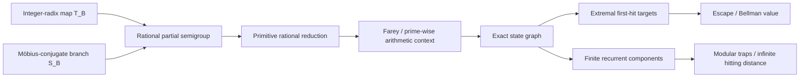
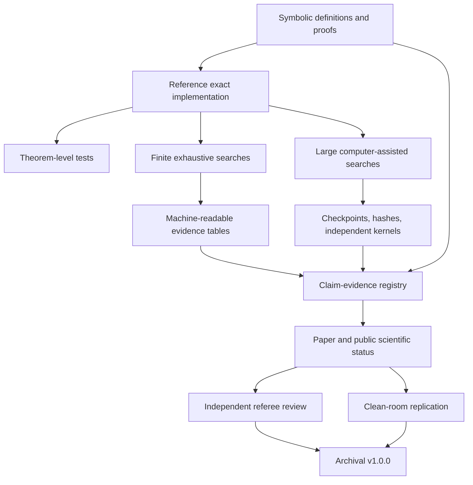
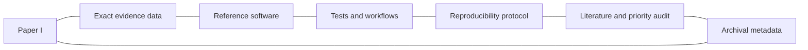

# RGΦ architecture

This document separates the mathematical system, the evidence pipeline, and the publication objects.

## 1. Mathematical architecture

The system is not presented as a direct golden-ratio digit correlation. The Fibonacci/golden-ratio structure enters through the projective chart \(H(x)=(1+x)^{-1}\) and its matrix identity.

## 2. Evidence architecture

Internal CI establishes deterministic consistency. It does not replace independent mathematical review or external replication.

## 3. Research-object architecture

The archival object is designed to be interpretable even when any single component is read independently.

## 4. Publication architecture

- **Paper I:** robust nonnested extremal targets.
- **Paper II:** hidden Farey / \(p\)-adic control, after a general theorem is established.
- **Paper III:** finite modular traps and basin structure, after a family theorem is established.
- **Computational companion:** exact search and certificate architecture.

The repository is broader than any one manuscript. The manuscripts must remain narrower than the repository.

## 5. Validation boundary

The project currently has:

- strong internal exact verification;
- strong research-object and archival infrastructure;
- a specialist-ready literature audit;
- a commit-pinned reviewer bundle.

It does not yet have:

- two independent mathematical referee reports;
- an external clean-room replication;
- a closed historical-priority assessment.

Those are the remaining pre-DOI scientific gates.
